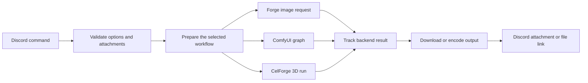
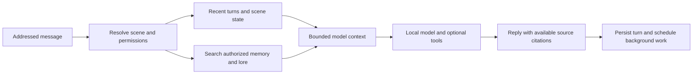

# How Elaina's AI features work

This guide connects the user-facing features to the code without requiring
experience with machine learning. For command examples, use the
[image](../document.md), [chat](ai-chat.md), and [media](media-commands.md)
guides. The explanations below describe this repository's implementation;
upstream projects can expose more features than the Discord commands support.

## One bot, several engines

Elaina receives Discord inputs, validates options, builds the appropriate
request, tracks its progress, and returns the output. Different services do the
actual inference.

| Engine or service | Its role in this bot |
| --- | --- |
| Forge Neo | Most image generation and editing, including native reference conditioning and supported image extensions |
| ComfyUI | H3 audiovisual graphs, video processing, image interrogation, and selected image-editing fallbacks |
| Local language-model server | Chat generation, optional image/video prompt enhancement, and composition planning |
| MongoDB, embeddings, and Qdrant | Durable chat records and retrieval of authorized memories, summaries, and lore |
| SearXNG and bounded page fetching | Optional public web evidence for chat |
| CelForge | Image-to-3D cases, runs, and exported meshes; the bot separately renders an orbit preview |
| Mapperatorinator | Audio-conditioned osu! beatmap generation, with its own request queue and controls |

Forge, ComfyUI, and local language-model traffic use the configured AI proxy.
CelForge uses its dedicated service URL and case/run protocol. The bot and
model servers can run on different machines: “local model” here means
operator-hosted inference, rather than a claim that every operation stays on
the Discord user's device.

Supported image and H3 commands can add a local language-model step before
submission. This is optional image prompt enhancement, audiovisual scripting,
or layout planning; it does not train the image/video model on the request.

## What happens inside an image generator?

A typical latent image workflow has three main parts. The **text encoder**
turns the prompt into conditioning vectors. The **diffusion model** repeatedly
updates a noisy latent representation using that conditioning. The **VAE**
converts between the compact latent representation and pixels. A checkpoint
and its companion encoder/VAE therefore need to match the model family.
The original [latent diffusion paper](https://arxiv.org/abs/2112.10752) explains
why doing the expensive generation in a compressed representation is useful.

The bot selects family defaults because the same slider values can mean
different things across models. **Steps** count sampling updates; **sampler**
and **scheduler** determine how those updates traverse the noise levels.
**CFG** adjusts guidance, while **shift** or distilled guidance is a separate,
family-specific control. More steps or a higher guidance value does not
guarantee a better image. See the
[classifier-free guidance paper](https://arxiv.org/abs/2207.12598) for the
underlying guidance idea, and the selected model's own instructions for its
actual settings.

Model filenames also describe storage and numerical formats. **BF16/FP16**
use 16-bit floating-point representations; **FP8/INT8** indicate lower-precision
formats. **GGUF** is a model container with metadata and tensor data, rather
than a model architecture or one particular precision. See the
[GGUF specification](https://github.com/ggml-org/ggml/blob/master/docs/gguf.md)
for the format. A smaller weight file can help a model fit, but encoders,
VAEs, intermediate tensors and caches still consume memory. File size alone
cannot predict the total VRAM requirement or generation speed.

A **seed** chooses the initial random state. It is useful for comparisons when
the workflow, model, dimensions, prompt, and other settings stay fixed. Changing
a backend version, adapter, or sampling implementation can still change the
result with the same seed.

### Why editing workflows are different

| Workflow | What the source image does | Typical consequence |
| --- | --- | --- |
| Img2img | Supplies an encoded starting image that is noised and regenerated | Denoise strength directly affects how far the result can move from that starting point |
| Reference editing | Supplies conditioning describing one or more references | The model interprets an edit instruction; it can recompose the image instead of preserving pixels |
| Inpainting | Supplies an image plus a mask identifying the edit region | Mask convention, blur, crop area, and model/control conditioning matter |
| Outpainting | Supplies the original image inside a larger canvas plus an edit mask | The model invents the new margins; overlap helps the join but can redraw boundary details |

Native multiple references are encoded as separate references. A stitched grid
or horizontal/vertical collage instead gives the model one combined image.
Neither form is an automatic identity lock: explain what each image contributes.
The [MOSS edit author's guide](https://huggingface.co/chinoll/Moss-Image-Edit)
provides examples of assigning roles to multiple references.

A **LoRA** is a learned adapter to a compatible base model. It can add a style,
subject, or editing ability; it is not a universal plug-in for every checkpoint.
**ControlNet** adds spatial guidance such as an edge map, pose, or inpaint
conditioning. The bot treats these as distinct mechanisms. For the underlying
ideas, read the [LoRA paper](https://arxiv.org/abs/2106.09685) and
[ControlNet paper](https://arxiv.org/abs/2302.05543).

## Upscaling can mean several different operations

Ordinary resizing or an Extras upscaler works on an existing image. Hires Fix
adds a larger generation pass; tiled latent upscaling divides supported
generation work into overlapping tiles. They have different costs and can
introduce different details or seams.

PiD is a generative decoder/upscaler, described in
[NVIDIA's model card](https://huggingface.co/nvidia/PiD). This bot's distilled
SDXL PiD workflow has a fixed 4× side-length increase, which means 16× as many
pixels. Compatible SDXL generation can use the integrated pass. Other supported
img2img/ref2img families first produce RGB pixels, then re-encode those pixels
with SDXL's VAE for a standalone PiD pass; the original checkpoint/modules are
restored afterward. That conversion is different from passing incompatible
latents directly into PiD. Txt2img currently exposes the integrated SDXL path.

These generative operations can invent texture. Increased resolution does not
prove that a small word, face, or object detail was recovered faithfully from
the source. The [image guide](../document.md#pid) lists the bot's
size limits and incompatible combinations.

## Prompt enhancement and layout planning

The image enhancer keeps the original prompt and appends validated additions.
This preserves user LoRA tags and trigger phrases. Auto style chooses tags or
natural language according to the model/workflow; an explicit user setting
wins. “Enhance all” shares one addition across the batch. “Enhance each” asks
for multiple additions in one language-model call, then runs separate image
requests so each image receives its own prompt.

Layout planning is a different path. It returns a validated scene description
and bounding boxes. MOSS receives a JSON layout prompt; supported SD/SDXL
models receive Forge Coupler regions instead. The
[MOSS model card](https://huggingface.co/OpenMOSS-Team/MOSS-Image-Base) explains
its natural-language, tag, and layout inputs. A saved layout retains the draft
so boxes can be scaled to a new canvas; it is not a saved generated image.

Image, video, and layout language-model work share a queue through model
unload. Waiting for verified unload before image/video inference avoids having
a large prompt model occupy the GPU needed by the renderer. A failed rewrite
or unconfirmed unload can therefore stop a request before rendering starts.

## Video is a timed audiovisual workflow

H3 has separate model paths for opening/ending frame conditioning and reference
conditioning. The bot's hybrid path combines supported references with frame
guides. Audio is generated alongside video; the prompt enhancer's preview of
an audio reference is metadata, rather than an audio transcription. These are
different parts of the pipeline. The
[H3 model card](https://huggingface.co/MiniMaxAI/MiniMax-H3) and
[audiovisual prompt guide](https://huggingface.co/MiniMaxAI/MiniMax-H3/blob/main/docs/VIDEO_PROMPT_WRITING_GUIDE_base_en.md)
explain the model and prompt structure.

The bot samples on a 24 fps, `17k+5` frame grid. For example, a five-second
request becomes 124 frames, about 5.17 seconds. Requests beyond 15 seconds
use chained clips with carried motion/audio context and trimmed overlap. This
is an extension workflow, rather than one arbitrarily long base-model sample.
See the [extender implementation](https://github.com/tritant/ComfyUI_MiniMax_H3_Extender)
and [media guide](media-commands.md) for the bot's narrower limits.

Resolution upscaling, frame interpolation, and color matching are separate
postprocessing stages. RIFE adds intermediate frames; it does not add missing
story events or repair an incorrect motion sequence. A single-image 3D run
similarly has to infer unseen surfaces: its orbit preview reveals the generated
asset, not measurements of the original object. The
[TRELLIS project](https://github.com/microsoft/TRELLIS) explains one of the
3D model families available through CelForge.

## How chat remembers without retraining

The chat service builds a bounded context from persona instructions, scene
state, recent turns, and relevant authorized evidence. It generates the next
reply from that context. Older useful information can be represented in
summaries, structured memories, or curated lore and retrieved later. This is
retrieval, rather than changing the language model's weights after each chat.
The [RAG paper](https://arxiv.org/abs/2005.11401) introduces the broader idea.

An **embedding** is a numeric representation useful for finding related text.
The hybrid retriever combines semantic similarity with lexical matching, then
rechecks the source records' authorization before returning evidence. Similarity
alone does not grant permission to another user's memory. MongoDB holds the
authoritative records; Qdrant is a retrieval index. See the
[E5 model card](https://huggingface.co/intfloat/multilingual-e5-small) for
embeddings and [Qdrant filtering](https://qdrant.tech/documentation/search/filtering/)
for metadata constraints.

For example, a scene can establish that a character owns a blue airship. A
later question about the character's transport can retrieve that scene fact
without treating it as a real-world fact about the player. Memories still need
correction and deletion controls because extraction and summaries can be wrong.
The [chat guide](ai-chat.md) explains those controls and their scopes.

Available chat tools include time, dice, authorized memory/lore search, and
optional web search/fetch. Tool arguments and budgets are checked by the
application. Public web lookup uses [SearXNG](https://docs.searxng.org/); it is
separate from private memory retrieval. Local inference is not a promise that
public web queries, Discord attachments, or externally hosted result files
never leave the operator's network.

## Why a request can wait, and what Cancel does

The image code holds a Forge **lease** across model selection, reference-mode
changes, setup, inference, and restoration. Participating generation requests
take turns on the same Forge instance. The lease coordinates those paths in
one bot process; direct WebUI actions and other clients retain their own
concurrency rules. Separate service instances need separate routing affinity.

The GPU orchestrator has a different responsibility: placement, resource
admission, workload reservations, and service handoff. Its policy depends on
the deployment. A model being on disk does not mean it is already loaded in
VRAM, so a cold request can spend time loading before sampling begins.

Forge's interrupt is global to its instance. The bot checks task ownership,
sends the Gradio interrupt with explicit instance routing, and drains it before
releasing its lease. Comfy cancellation uses the returned prompt ID and
instance to remove or interrupt that specific job. The bot waits for backend
evidence that work stopped; deleting a progress message alone would not stop
GPU work. CelForge's current Discord command does not expose this Cancel UI.

ComfyUI progress uses WebSocket events with history polling as a recovery path
for cached results or missed events. Learn the underlying node/graph model in
the [official ComfyUI documentation](https://docs.comfy.org/). Cancellation and
status control requests must remain routable even while generation occupies
the GPU; they do not reserve capacity for another generation.

## Continue into the implementation

For contributors: why a backend update can break a command

Forge generation uses Gradio callbacks. A `fn_index` identifies the callback,
and an ordered array supplies its UI input values. A WebUI update can change
either part even when the Discord command's options stay the same. Compare
the live `/config` signatures with the payload builders and
[`forge_schema.test.js`](../tests/forge_schema.test.js); a guessed numeric
offset cannot establish that the arguments still mean the same thing.

ComfyUI has a similar contract at the graph level: each node has named inputs,
typed connections, and output indexes. Updating a custom node can change those
inputs or remove a node used by a saved workflow. The bot's workflow builders
and installed backend nodes need compatible versions.

Discord also bounds option and choice lists. The model menus deliberately use
curated, experimental, and legacy selections instead of one unbounded list.
A model file being installed and a checkpoint appearing in a particular
command's dropdown are separate facts.

| Question | Source to start with |
| --- | --- |
| Which commands and options exist? | [`commands/`](../commands) and [`Bot.js`](../Bot.js) |
| Which image families/defaults are configured? | [`ai_server_config.js`](../utils/ai_server_config.js), [`model_defaults.js`](../utils/model_defaults.js), [`imggen_default_config.json`](../resources/imggen_default_config.json) |
| How do image/ref/inpaint requests share execution? | [`forge_image_command.js`](../utils/forge_image_command.js), [`forge_image_job.js`](../utils/forge_image_job.js), [`forge_reference.js`](../utils/forge_reference.js) |
| How are H3 and postprocessing graphs built? | [`comfy_media.js`](../utils/comfy_media.js), [desktop H3 workflows](../resources/workflows/h3/README.md) |
| How do prompt additions and layout compilation work? | [`image_prompt.js`](../utils/image_prompt.js), [`video_prompt.js`](../utils/video_prompt.js), [`moss_layout.js`](../utils/moss_layout.js) |
| How are backend jobs cancelled? | [`forge_cancel.js`](../utils/forge_cancel.js), [`comfy_prompt.js`](../utils/comfy_prompt.js), [`comfy_image_job.js`](../utils/comfy_image_job.js) |
| How are memories selected and authorized? | [`retrieval.js`](../chat/retrieval/retrieval.js), [`repository.js`](../chat/persistence/repository.js) |
| How do chat tools execute? | [`chat/tools/`](../chat/tools) and [`context_builder.js`](../chat/conversation/context_builder.js) |
| What does the 3D command actually submit? | [`celforge_client.js`](../utils/celforge_client.js), [`model_orbit.js`](../utils/model_orbit.js) |

For deployment, retention, failure recovery and local checks, continue with the
[chat operator guide](chat-overhaul/OPERATOR_GUIDE.md),
[media setup](media-commands.md#setup), and
[orchestrator handoff](orchestrator-handoff.md). Dated
[H3 measurements](h3-benchmark.md) explain what was measured and what those
numbers exclude. They should not be read as a latency promise for a new job.
